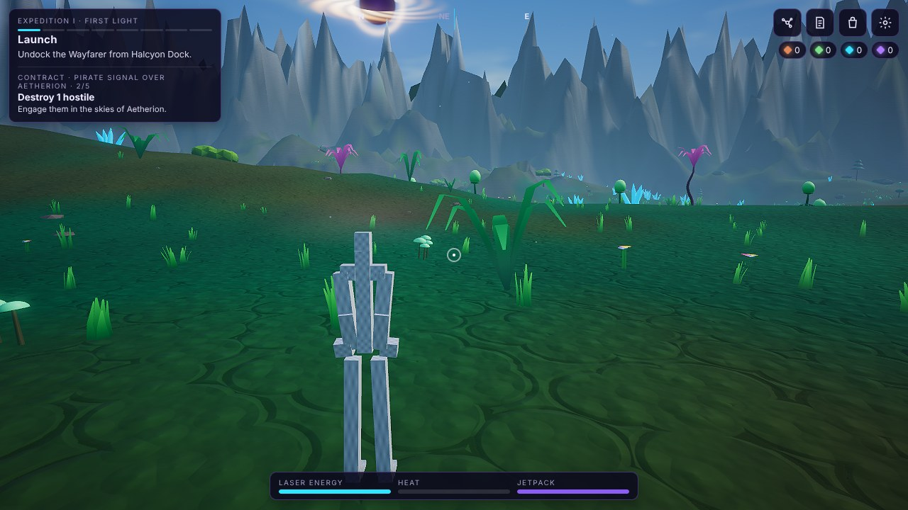
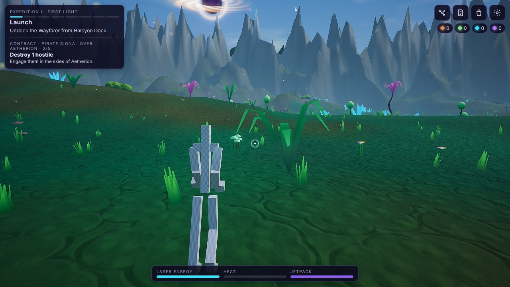

# GLB / glTF 2.0 + PBR asset pipeline (Android Full)

Hero assets are **authored in Blender (or bought/commissioned), exported as glTF 2.0 / GLB, and loaded at runtime** — never modelled from primitives in code.
This document is the contract for those assets and for the code that loads them. Status of each part is stated honestly at the end.

## Architecture

```
assets/models/                      authored files, in git (licences recorded)         ── only copied into FULL builds ──
  manifest.json   CREDITS.md   astronaut/*.glb  (decoders/ optional)
        │ scripts/build.mjs  (copyModels; never for Lite)
        ▼
dist/preview/models  dist/web/models  android/.../assets/www/models   →  inside the APK, served by WebViewAssetLoader (offline)

runtime (src/presentation/full/):
  astronautHero.ts        Player-facing character. Starts as the procedural fallback; if the tier is Enhanced/Extreme HD it fetches
                          models/manifest.json, loads the astronaut GLB, normalises it (height, feet on ground, auto-facing), swaps it in.
  assets/glbLoader.ts     Babylon's official glTF 2.0 loader via its tree-shakeable `.pure` entry points; offline-safe extension set;
                          never throws into gameplay; hard timeout; resolves { ok:false, reason } on any failure.
  assets/humanoidRig.ts   Finds the 21 standard humanoid bones in ANY authored skeleton by normalised name
                          (Mixamo, Rigify/Blender, Reallusion CC / AccuRig, 3ds Max Biped, …). Pure; unit-tested.
  assets/rigDriver.ts     Retargeting: poses any humanoid skeleton from joint commands, independent of rest pose (T/A) and bone-axis
                          convention (world-delta solve; see file header). Arms are brought from T-pose to hanging automatically.
  assets/gait.ts          Pure locomotion state machine (idle/walk/run/air/jet/aim/landing) -> joint angles. Same inputs/blends as before.
  astronautFull.ts        The Checkpoint A procedural astronaut — kept ONLY as the safe fallback. Not the realistic character.
src/presentation/astronaut.ts  facade: Full -> astronautHero; Lite build plugin -> astronaut.lite.ts (the original simple model).
```

* **Gameplay isolation.** Movement physics, collider sizes, hit-boxes, boarding, interaction positions, mining, input and the camera live in `Player`/`Game` and are
  untouched. The model only receives `animate(dt, speed, grounded, jetting, aiming, aimPitch, vy)` and is positioned/rotated by the player. The mining beam starts at
  `model.muzzle`; for an authored model that is a node placed just past the right hand along the forearm direction each frame.
* **Lite is unaffected.** The loader, rig code, hero asset folder and the relaxed `connect-src 'self'` CSP are Full-only. `tests/package-boundary.test.ts` proves Lite
  contains none of them and that Lite builds get no `models/` folder.
* **Offline / APK.** Models are copied into the APK's `assets/www/models/` and fetched from the same origin (`https://appassets.androidplatform.net`). The CI APK job fails
  if `assets/www/models/manifest.json` is missing from the APK. The APK still has **no INTERNET permission**.
* **Safe fallback** (`window.__GF.state().astronaut` reports which is on screen):
  no manifest / no `astronaut` entry → procedural; GLB 404 / corrupt / timeout → procedural, `mode: "failed"` with the reason; skeleton missing required humanoid bones → procedural;
  Basic tier → procedural, no request is made. Verified in the real game by `scripts/hero-asset-test.cjs` (11 checks).

## Manifest (`assets/models/manifest.json`)

```json
{
  "version": 1,
  "assets": {
    "astronaut": {
      "variants": { "enhanced": "astronaut/astronaut-1k.glb", "ultra": "astronaut/astronaut-2k.glb" },
      "height": 1.8,
      "yaw": null,
      "license": { "name": "CC BY 4.0", "url": "https://creativecommons.org/licenses/by/4.0/",
                   "author": "…", "source": "https://sketchfab.com/…", "title": "…" }
    }
  },
  "decoders": { "draco": { "wasmUrl": "decoders/draco_wasm_wrapper_gltf.js", "wasmBinaryUrl": "decoders/draco_decoder_gltf.wasm", "fallbackUrl": "decoders/draco_decoder_gltf.js" } }
}
```

`variants` is the per-tier level of detail (texture size and triangle budget): Extreme HD uses `ultra`, Enhanced uses `enhanced`, Basic never loads a model. `yaw` is optional:
when absent the facing is measured from the foot -> toe direction. **Every entry needs a licence record**, and every CC-BY asset needs a line in `assets/models/CREDITS.md`.

## Asset requirements (what an artist must deliver)

* glTF 2.0 binary (.glb), metres, Y-up, character ~1.8 m, feet near y = 0, T- or A-pose, facing +Z (or any: facing is auto-detected from foot/toe bones).
* Single skinned mesh set; humanoid skeleton with the standard bones (hips, spine, chest, neck, head, shoulders, upper/fore-arms, hands, up-legs, legs, feet, toes; fingers optional
  and ignored). Names in Mixamo / Rigify / Reallusion CC / Biped style map automatically; others fail loudly into the fallback with the missing-bone list.
* PBR metallic-roughness materials with authored maps: base colour, normal (baked from a high-poly sculpt), occlusion-roughness-metallic (ORM), emissive where lit. Budget: Extreme HD 2K, Enhanced 1K.
  No flat vertex-colour plastic: the visor must be a real reflective material, fabric and armour need distinct roughness.
* Triangles: target ≈ 30-40k for the Extreme HD variant, ≈ 12-15k for Enhanced — **guidance, not a hard cap**; visual fidelity in the finished game is the judge.
* Animation clips are welcome (idle/walk/run/jump/fall/land/jet/aim/mine) but the current driver does not yet play them — see status.

## Preparing / compressing a model (offline, in the artist's or CI toolchain)

```
npm i -g @gltf-transform/cli
gltf-transform optimize in.glb out.glb --texture-compress webp --texture-size 2048      # WebP is decoded by the WebView itself (no extra files)
# Optional, only if the matching decoder files are shipped in assets/models/decoders and listed in the manifest:
gltf-transform draco  in.glb out.glb                      # KHR_draco_mesh_compression (decoder wasm needed)
gltf-transform ktx    in.glb out.glb --slots "*"          # KHR_texture_basisu / KTX2 (transcoder wasm needed)
```
Draco / KTX2 are registered **only** when the manifest supplies decoder URLs — otherwise Babylon would try a CDN download, which an offline APK must never do. A model that needs
an unregistered extension fails to load and the game falls back.

## In-game pipeline proof (a TEST RIG — not the visual standard)

The frames below are the real game (Extreme HD, Aetherion) running a skinned GLB through this pipeline. The model is the generated box-built test rig
(`scripts/make-test-glb.cjs`) on purpose: it proves loading, skinning, normalisation (1.80 m, feet on the ground, auto-facing), retargeted animation and the muzzle, with no
licensing question. **It is deliberately ugly; it demonstrates the mechanism, not the look.** The look comes from an authored asset (see `docs/ASSET-RESEARCH.md`).

| Idle | Running (retargeted gait) |
|---|---|
|  |  |

Checked by `scripts/hero-asset-test.cjs` (11 checks): no assets shipped -> procedural; valid GLB adopted (264 tris, ~5 s load under software rendering); height 1.80 m and feet on the
ground; muzzle follows the hand; missing GLB -> fallback; corrupt GLB -> fallback; Basic tier makes no request.

## Status — implemented vs not

| Piece | State |
|---|---|
| GLB/glTF 2.0 loading, PBR materials, skins, WebP textures | **Implemented, tested** (headless loader tests + real game) |
| Humanoid bone mapping across rig conventions | **Implemented, unit-tested** (Mixamo, Rigify, CC, Biped) |
| Skeleton retargeting for any rest pose; arms-down from T-pose | **Implemented, numerically verified** (limb directions match the procedural rig) |
| Skinned character in the real game, normalisation, auto-facing, muzzle, fallbacks, Basic-tier skip | **Implemented, verified in-game** with a generated *test rig* (`tests/fixtures/humanoid-test.glb`) |
| Offline APK packaging + CI check, strict-CSP update, Lite exclusion | **Implemented**; APK content check runs in CI (not yet seen green on this commit) |
| Per-tier variants (texture/triangle budget) | **Implemented** (manifest `variants`) |
| Draco / KTX2 compressed assets | **Wired, unverified** — no compressed asset or decoder files exist in the repo to test with |
| Distance LOD for the character | **Not implemented**; the camera is 3-7 m away on foot, so tiers cover it. Needed later for NPC crowds |
| Playing authored animation clips (Mixamo walk etc.) | **Not implemented**: the rig is driven procedurally. Planned: blend clips by name for idle/walk/run, keep procedural poses for aim/jet/land |
| Mining-tool prop, finger/grip animation, twist-bone driving | **Not implemented**; the beam starts at the hand; IK-chain twins (right arm of the tnnv rig) **are** handled |
| Jetpack flames for the authored model | Simple cones, **not visually verified on a real asset** |
| A real, licensed, realistic astronaut in the game | **Done: tnnv "Spacesuit (Confederation of Planets)", CC BY 4.0 — see `docs/ASTRONAUT-TNNV.md`** (awaiting the owner's appearance approval) |
| Real-device performance of any of this | **Not measured** |

Bundle impact (Full): +~260 KB JS for the loader (the loader's OpenPBR material, ~230 KB, is stubbed out because glTF here uses the standard PBR material). Lite: unchanged.
