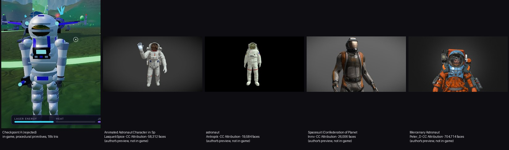

# Astronaut asset research (Android Full hero character)

Purpose: find professionally authored, realistic, rigged, PBR astronaut models whose licence allows redistribution inside a game.
Method: Sketchfab's public search/model API (licence, face counts, animation counts, previews), the NASA 3D Resources repository (file tree + the files
themselves), NASA's media-usage guidelines page, and marketplace listing pages. **Nothing below has been downloaded into the game or committed to the repo.**

> **Blocker, stated first.** Every Sketchfab download endpoint answers `HTTP 401` without an account token (checked for all five Sketchfab candidates), so I cannot
> fetch any of them from the cloud sandbox. A prototype in the game with a real candidate needs **you** to download a GLB (free Sketchfab account for the CC-BY models,
> or a purchase) and drop it into `assets/models/` — or to authorise another route. See "What I need from you".

Preview sheet (left = Checkpoint A, in-game; right = the authors' own preview renders, **not** in-game): `docs/asset-research/comparison.jpg`

Preview images are the authors' thumbnails of CC-BY models, shown for evaluation with credit to: LasquetiSpice, Antropik, tnnv, Peter_D (Sketchfab).

## Shortlist

| # | Model | Source / URL | Licence (verified from the source's own metadata) | Price | Formats | Rig / animation | Geometry & textures | Mobile cost estimate* | Verdict |
|---|---|---|---|---|---|---|---|---|---|
| 1 | **"astronaut" — Antropik** | [Sketchfab](https://sketchfab.com/3d-models/none-482bf87662fd4b378bcb3a2931d59ca3) | **CC BY 4.0** ([text](http://creativecommons.org/licenses/by/4.0/)): commercial use and redistribution allowed with attribution | Free | Sketchfab serves glTF/GLB for downloadable models (not verifiable here: 401) | **Rigged; 5 animation clips** (API `animationCount: 5`) | 19,584 faces, 1 material, 5 textures, 4K textures per the author | ~20k tris (x2 with the shadow pass), 1 material; texture memory dominates: a 2K RGBA map is ~22 MB with mips uncompressed (GPU-compressed formats cut that 4-6x) | **Best immediate path.** NASA-EMU style white suit. Made "pretty quickly" for a Roblox game: expect good silhouette, moderate surface detail. Needs an artist's eye before it is "final". |
| 2 | **"Spacesuit (Confederation of Planets)" — tnnv** | [Sketchfab](https://sketchfab.com/3d-models/none-da7b5c14bc634f8283e2d21343afa7cc) | **CC BY 4.0** | Free | glTF/GLB (as above) | **Not rigged** (0 clips). The author says it is "game-ready… for third-person view" and points to Reallusion's free **AccuRig** auto-rigger; our bone mapper already understands the CC / AccuRig names | 26,006 faces, 4 materials, 10 textures | ~26k tris, 4 draws | **Best sci-fi look** of the free options (hard-shell semi-realistic suit, helmet with visor). Needs one rigging step (AccuRig, GUI tool) from you or an artist. |
| 3 | **"Animated Astronaut Character in Space Suit" — LasquetiSpice** | [Sketchfab](https://sketchfab.com/3d-models/animated-astronaut-character-in-space-suit-loop-8fe5c8d3365e4d87bb7bc253d53a64e1) | **CC BY 4.0** | Free | glTF/GLB (as above) | **Rigged; 4 clips** (walk, wave, drift, idle) | 58,312 faces, 10 textures | ~58k tris: too heavy for the shadow-casting hero without a LOD/decimation pass | Realistic NASA-style suit with ready clips. Note: two other uploads have the identical 58,312-face count (Javi_DaviYT, LeonardoLamKengy) — probably re-uploads; use only the original and check its provenance. |
| 4 | **"Mercenary Astronaut" — Peter_D** | [Sketchfab](https://sketchfab.com/3d-models/none-7fd399d488ae4576a0fc62715892956c) | **CC BY 4.0** | Free | glTF/GLB (as above) | Rigged-looking; 3 clips | **704,714 faces, 22 materials, 109 textures** | Far too heavy as is (~35x a sensible mobile budget) | The most cinematic look of all (weathered orange suit, detailed helmet). **Not usable without retopology + texture baking** — a commissioned LOD0/LOD1 pass, or a reference for a commission. |
| 5 | **"Astronaut in Spacesuit — rigged and animated" — Adrian Kulawik** | [RenderHub](https://www.renderhub.com/adriankulawik/astronaut-in-spacesuit-rigged-and-animated) | **RenderHub "Extended Use License"**: "for both non-commercial and commercial purposes, in a variety of mediums and applications" (summary on the listing; **I have not read the full licence text** — confirm that shipping the model inside a distributed game is covered before buying) | **US$ 99.00** (listing) | .blend, .fbx, .dae, .obj, .abc (**no GLB**: export from Blender) | **Rigged + animated**, PBR | 28,642 polys / 29,844 verts, 4K PBR (albedo with edge wear, normal baked from a 2 M-poly sculpt, roughness, metallic, bump) | ~29k tris, PBR 4K -> down-res to 2K/1K variants | **Best quality-per-effort if a purchase is approved.** Baked high-poly detail is exactly what Checkpoint A lacked. Needs your explicit approval to buy. I could not fetch its preview image (CDN returns 403 to the sandbox) — see the listing. |

\* Estimates from the listed counts, not measurements. Real cost needs a device run.

## Looked at and rejected

* **NASA 3D Resources** ([github.com/nasa/NASA-3D-Resources](https://github.com/nasa/NASA-3D-Resources)): real, accurate suit models exist as GLB — *Astronaut* (6,381 tris, 4 WebP textures), *Z2 Spacesuit* (30,904 tris, 6 WebP PBR textures, 16.9 MB), *Mark III* (69k), *Mercury* (110k), *Gemini* (114k), *Advanced Crew Escape Suit* (89k), *EVA suit* (6.4k), *Astronaut Glove*. I downloaded them **for inspection only** (outside the repo). Findings: **all are unrigged single-mesh statues** (0 skins, 0 animations); several use Draco + WebP (our pipeline supports both when decoders are shipped). Licence: the repo README says "free and without copyright", and NASA's media-usage guidelines say NASA 3D content "generally [is] not subject to copyright in the United States", may be used for "educational or informational purposes… computer graphical simulations", "used in a factual manner that does not imply endorsement", with NASA acknowledged; **the NASA insignia/logotype are not public domain**. That is **not a clean grant for a commercial game**, and the textures may carry insignia. **Not integrated.** If you want a NASA suit as a *static* prop (e.g. a monument), that is a decision to take with whoever advises you on licensing.
* **TurboSquid "Apollo 11 A7L Spacesuit Rigged"** ($75): listing says *Editorial Uses Only* — unusable in a game.
* **CGTrader EMU/SAFER suit** ($16 in search snippet): not described as rigged; listing pages did not load for verification.
* **Space Engineers Astronaut (Keen Software House, CC BY)**: 11,940 faces, 3 textures, no animation clips, rig unknown; a game-style design and a third-party game's IP — avoid.
* Stylised/low-poly astronauts (Quaternius, Kenney, "Chibi", "Among Us"): fail the realism target by design.

## Recommendation

1. **Fastest legitimate prototype (free):** you download **#1 Antropik** as GLB from Sketchfab (free account), put it in `assets/models/`, add the manifest entry (see `docs/ASSET-PIPELINE.md`) and add the credit to `assets/models/CREDITS.md`. I then wire, tune and screenshot it in-game. Expect "decent, not final".
2. **Best free look:** **#2 tnnv** + AccuRig (free). One manual rigging step.
3. **Best result for the stated target (realistic, cinematic):** buy **#5** (after you check its licence text and approve the US$ 99), *or* commission a bespoke hero astronaut — brief: ~30-40k-tri LOD0 + ~12k LOD1, 2K PBR set baked from a high-poly sculpt (albedo with wear, normal, ORM), Mixamo-compatible skeleton with finger bones, clips: idle, walk, run, sprint, jump, fall, land, jetpack hover/thrust, mining aim; delivered as GLB; licence assigning redistribution rights in a game. I can't verify commission prices; get quotes.
4. **Not recommended:** continuing procedural primitives; the NASA statues without a licensing decision and a rigging pass.

## What I need from you

* Approve a route: (a) you download #1/#2/#3 yourself, (b) approve buying #5 (US$ 99; I will not purchase), (c) commission an artist, or (d) tell me to try another source.
* If you choose a CC-BY model: nothing else; I add the required attribution. If you buy: tell me the licence you received so it can be recorded.
* I will **not** accept a Sketchfab API token in the chat; a manual download is safer.
