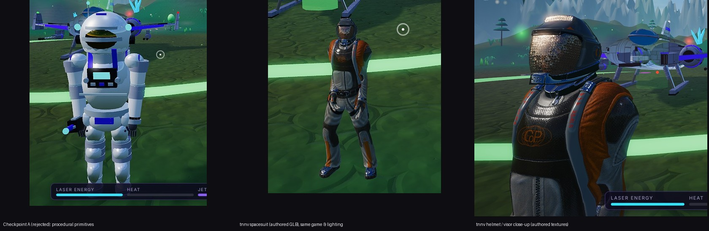
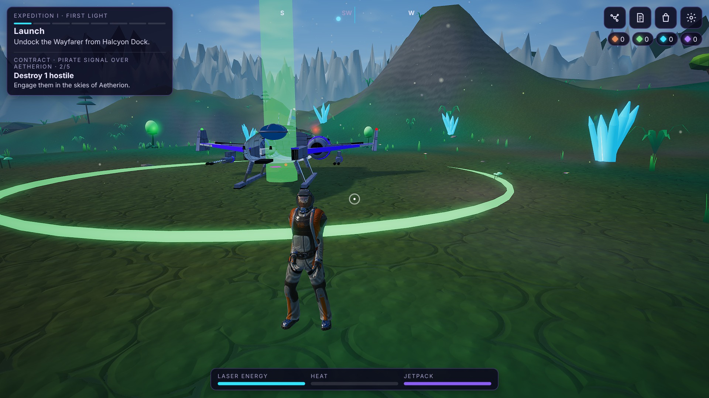
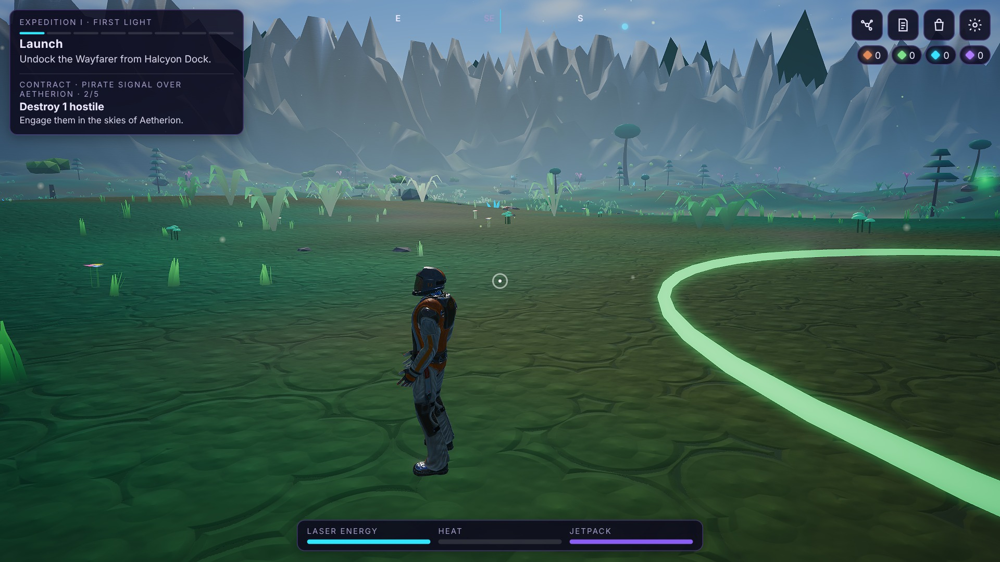
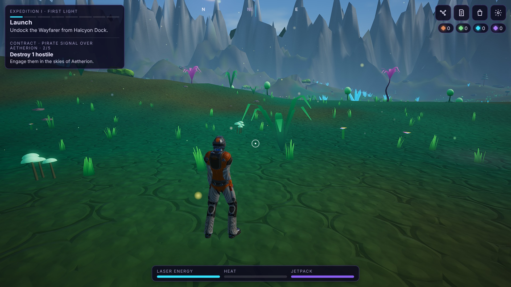
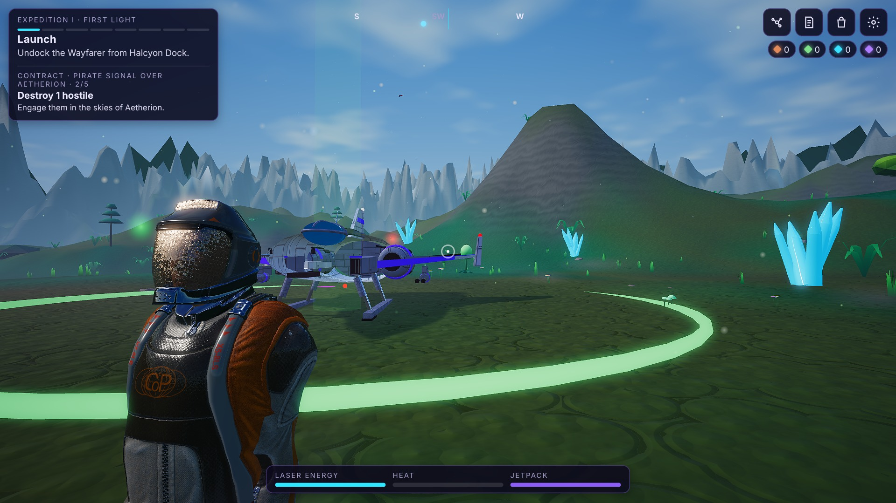
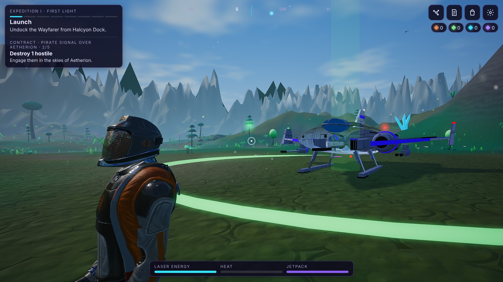
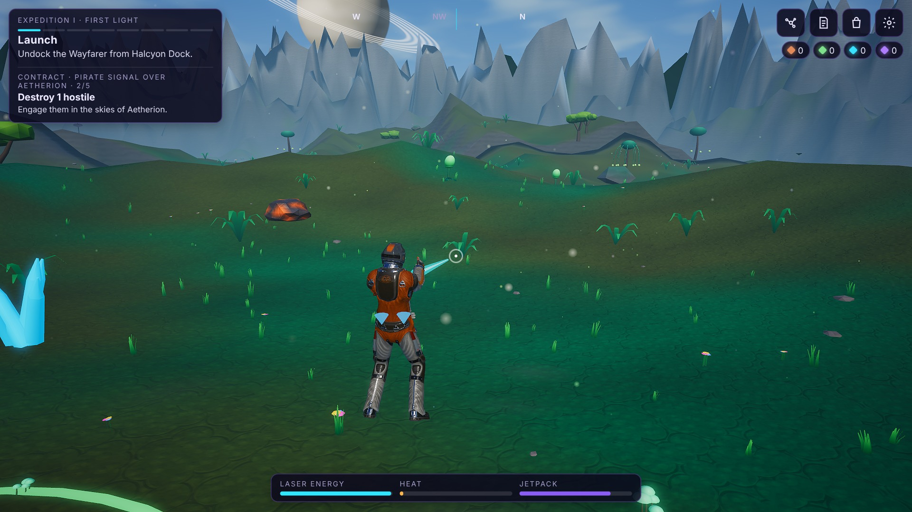
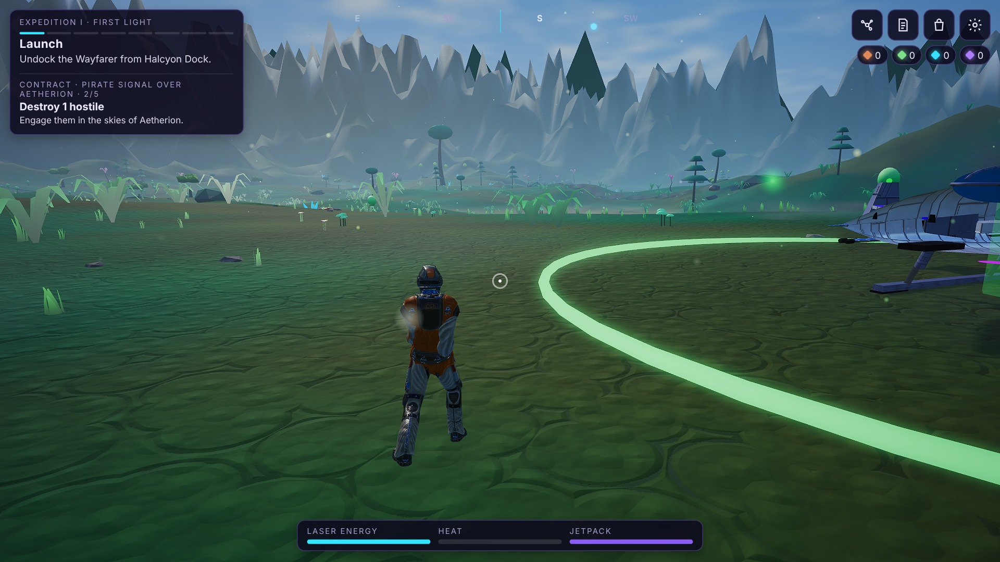
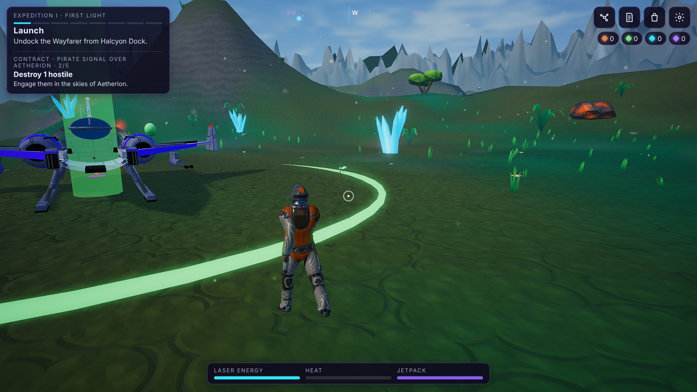
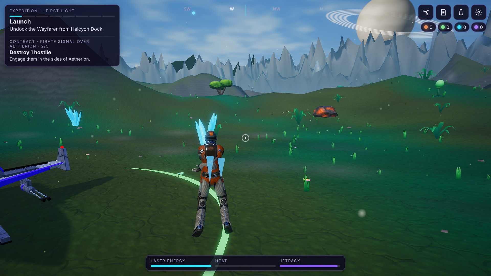

# Android Full astronaut: tnnv "Spacesuit (Confederation of Planets)"

The authored model you uploaded is now the Android Full astronaut. The procedural astronaut remains only as the fallback (no asset / load failure / Basic tier).
**This is for your appearance approval. Nothing beyond the astronaut has been started: no planet work.**

> **Not measured on a real phone.** Every image and number here is the real game in headless Chromium with a software rasteriser (Extreme HD preset, Aetherion). They show
> appearance and geometry/texture cost, not FPS. The APK has never been run on an Android runtime by me.

## 1. The model, inspected (the uploaded file itself)

| Fact | Value (read from the GLB) |
|---|---|
| File | `assets/models/astronaut/tnnv-spacesuit.glb`, 23,750,756 bytes, SHA-256 `b7f82d87b261b1ee8bccfd99f289dd299e0ab39e8e13be39c14d10b0ce7bcf31`; **byte-identical to your upload** |
| Geometry | **26,006 triangles**, 4 meshes: *Spacesuit* 13,946 (skinned), *Body* 10,250 (skinned; the wearer inside the suit), *Helmet* 1,498 and *Glass* 312 (rigid, parented to the head bone) |
| Skeleton | **1 skin, 70 joints**, Unreal-Mannequin-style: `pelvis`, `spine_01-03`, `neck`, `head`, clavicles, upper/lower arms with twist bones, hands with 15 finger bones, thighs/calves/feet/`ball` (toe) with twist bones, plus IK helper bones |
| Animation clips | none (as you said) |
| Materials / textures | 4 PBR metallic-roughness materials, 8 embedded PNGs: Spacesuit 2K base colour + 2K metal-rough + 2K normal; Body 1K base colour; Helmet 2K base colour + 2K metal-rough + 2K normal; Glass 512 normal (+ tinted, alpha-blended base colour). **Used exactly as authored — no texture or material was changed.** |
| Embedded metadata | `asset.extras`: author `tnnv`, licence `CC-BY-4.0`, source URL, title — identical to the Sketchfab page |
| Scale / frame | root nodes carry a 0.01 scale and 90° rotations (FBX export); handled generically |

**Rig findings that mattered** (they are why a naive retarget would have torn the mesh):
1. Skin weights put the **forearm on the twist bones** (`lowerarm_twist_01_*`, weight ≈ 703) rather than `lowerarm_*` (≈ 135).
2. On the **right arm the twist bone and the hand hang under an IK chain** (`upperarm_ik_r` -> `lowerarm_ik_r`, zero skin weight themselves) while `lowerarm_r` is a leaf. Posing only the FK bones would leave the right forearm and hand behind.
3. Unskinned **Helmet/Glass** are children of `head_07` and follow the head automatically.
4. The authored rest pose is slightly asymmetric (the right hand rests ≈ 12 cm further forward than the left); this is kept.

## 2. Licence verification

| Source | Result |
|---|---|
| Sketchfab API (queried 2026-11-05) | `CC Attribution` (CC BY 4.0, http://creativecommons.org/licenses/by/4.0/); requirement text: "Author must be credited. Commercial use is allowed."; author **tnnv** (https://sketchfab.com/tnnv); 26,006 faces; downloadable |
| The GLB's own `asset.extras` | author tnnv, `CC-BY-4.0`, same source URL, same title |
| Tests | `tests/glb-pipeline.test.ts` asserts the shipped bytes match the manifest hash and that manifest, `CREDITS.md` and the file's embedded metadata agree |

Credit and attribution, as CC BY 4.0 requires:
* `assets/models/CREDITS.md` and the manifest `license` block (author, source, licence name + URL, "changes: none to the file; poses are applied at runtime");
* **in the game**: Settings -> "Credits" lists *"Spacesuit (Confederation of Planets)" by tnnv — CC BY 4.0 · <source URL>* whenever the authored astronaut is active (checked by `scripts/hero-asset-test.cjs`);
* the file ships inside the APK together with `CREDITS.md`.

I am not a lawyer; CC BY 4.0 with visible attribution and a link to the licence is what the licence asks for.

## 3. What was built for this skeleton

* **Bone mapping** recognises the 21 standard humanoid bones; the IK-chain twins are detected (`upperarm_ik_r_033`, `lowerarm_ik_r_034`) and receive the same pose commands as their FK primaries; pure IK targets (`foot_ik_*`) are not mistaken for deformation bones.
* **Retargeting of the existing character animation**: the game's own states — idle (breathing, weight shift, slow head scan), walk, run (lean, arm swing), jump/air tuck, landing compression, jetpack posture, aim/mining arm raise — drive the skeleton through the pose solver (`rigDriver.ts`/`gait.ts`), whatever the rest pose. The model has no clips, so this is procedural posing of the authored skeleton, not clip playback. Rest positions use live world matrices so the 0.01 scale / 90° export nodes are handled.
* **Normalisation**: height 1.8 m, feet on the ground, facing measured from foot -> ball bones (no per-asset yaw).
* **Gameplay untouched**: `Player` movement/physics, collider sizes, hit-boxes, boarding, interaction distances, camera, input and every rule are unchanged. The mining beam still starts at `model.muzzle`, now placed just past the right hand along the forearm.
* **Jetpack**: the authored suit has a backpack but no nozzles, so two flame cones are placed from the real geometry (rearmost back vertices) and lean with the torso.
* **Glass**: the transparent visor does not receive shadow-map shadows (it showed shadow-acne speckle).
* **Package split**: Full only. The Telegram Lite build gets none of the model, loader or manifest (boundary tests); Lite keeps its original simple astronaut.

## 4. Screenshots (the real game, Extreme HD, Aetherion)

Front / side / rear, helmet close-ups, walk, run, jetpack, mining pose, normal gameplay distance: `docs/checkpoints/tnnv/*.jpg`.

| Front | Side | Rear |
|---|---|---|
|  |  |  |
| **Helmet / visor** | **Helmet 3/4** | **Mining pose** |
|  |  |  |
| **Walk** | **Run** | **Jetpack** |
|  |  |  |

Honest notes on what you will see:
* The honeycomb on the visor is **authored** (tnnv's glass normal map is a faceted pattern); I did not add or smooth it.
* Walk/run frames are taken from behind because the camera follows the movement direction.
* At ~0.5 fps under software rendering, blends are slow: in the mining frame the jet flames have not finished fading after the jetpack key was released (they fade in well under a second at real frame rates).
* Fingers are left in the authored relaxed pose (not animated); the twist bones are not driven; there is no tool prop in the hand (the beam starts at the hand).
* This is the model at screenshot size on a 1080p frame; judging it on your phone is the real test.

## 5. Cost (geometry and memory; **not** FPS)

| | Value |
|---|---|
| Triangles / draw calls | 26,006 across 4 meshes = 4 draws (x2 with the shadow pass); the procedural fallback was 18,272 tris / 41 draws |
| Skinning | 70 joints on 2 skinned meshes |
| Textures | 8 PNGs; ≈ **140 MB of GPU memory** if kept uncompressed with mips (Spacesuit 66 MB, Helmet 66 MB, Body 6 MB, Glass 1 MB) — heavy for mid-range phones, plausible for a flagship; GPU-compressed variants (KTX2/ASTC) would cut it ~4-6x but need the transcoder files and a conversion step (not done) |
| Download | 23.75 MB GLB inside the APK (the debug APK grows by about that much) |
| Load time | ≈ 6-15 s under software rendering on the cloud box; **real-device load time unknown** |
| Bundle | +~260 KB JS for the loader (Full only) |

If device testing shows memory or load-time pressure, the manifest supports a lighter `enhanced` variant (e.g. 1K textures) without code changes.

## 6. Verification

Run on this commit (software rendering): typecheck, unit tests 127/127 (new: hash/licence consistency, structure, skeleton mapping, IK-twin symmetry on the real model), hero-asset pipeline test in the real game incl. the real model (adoption, skeleton understanding, credit data, 1.8 m/feet, Settings credit text, fallbacks), Full Extreme HD journey **with the real astronaut loaded**, Lite journey, parity, M1 smoke, M2 suite — results are in the PR description. CI results and the APK artifact are listed there too.

## 7. Implemented vs still planned

| | State |
|---|---|
| Authored astronaut replaces the procedural one visually (Full, Enhanced/Extreme HD) | **Done**; fallback kept |
| Original textures and materials preserved | **Done** (byte-identical file, no material edits) |
| Skeleton verified, IK-twin arm handled, existing animation states retargeted | **Done** |
| Credit to tnnv (CC BY 4.0): file, manifest, in-game Settings, APK | **Done** |
| Lite and gameplay unchanged | **Done** (tests) |
| Finger/grip animation, twist bones, mining-tool prop, authored clips, foot planting | **Not done** |
| Texture compression / lighter variant | **Not done** (see cost) |
| Real-device FPS / memory / thermals | **Not measured** — needs your iQOO 13 (`?perf=1`) |
| Planet overhaul | **Not started — waiting for your approval of this look** |
