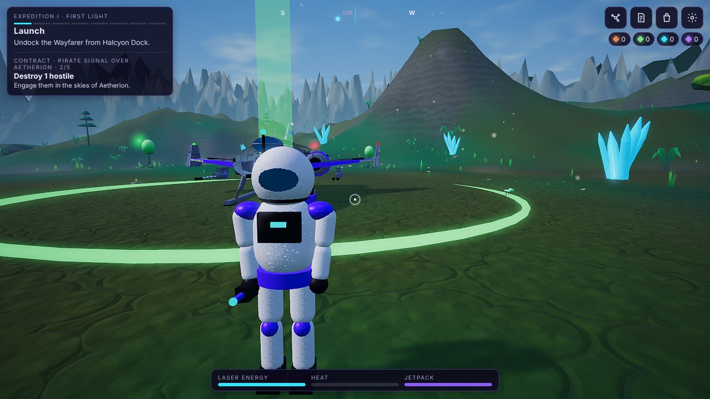
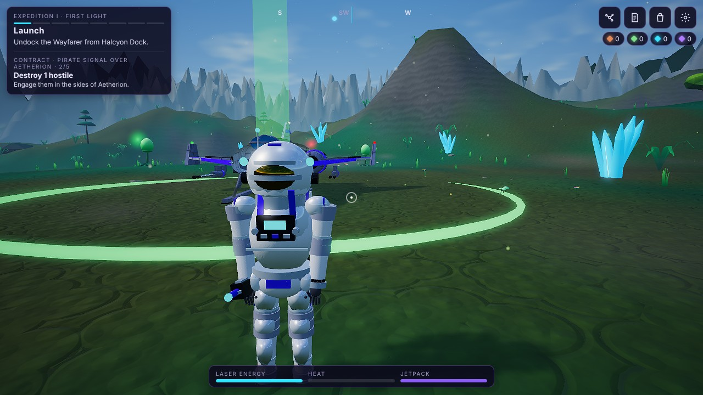
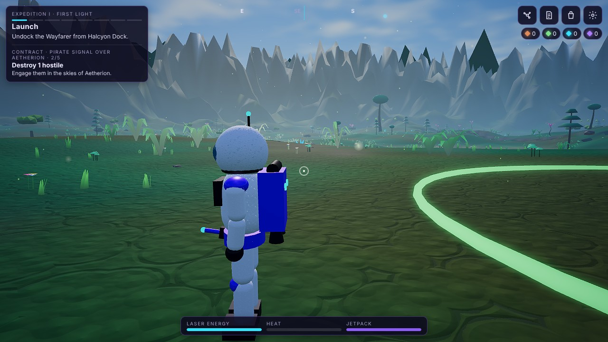
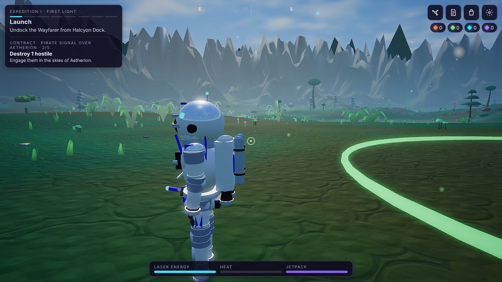
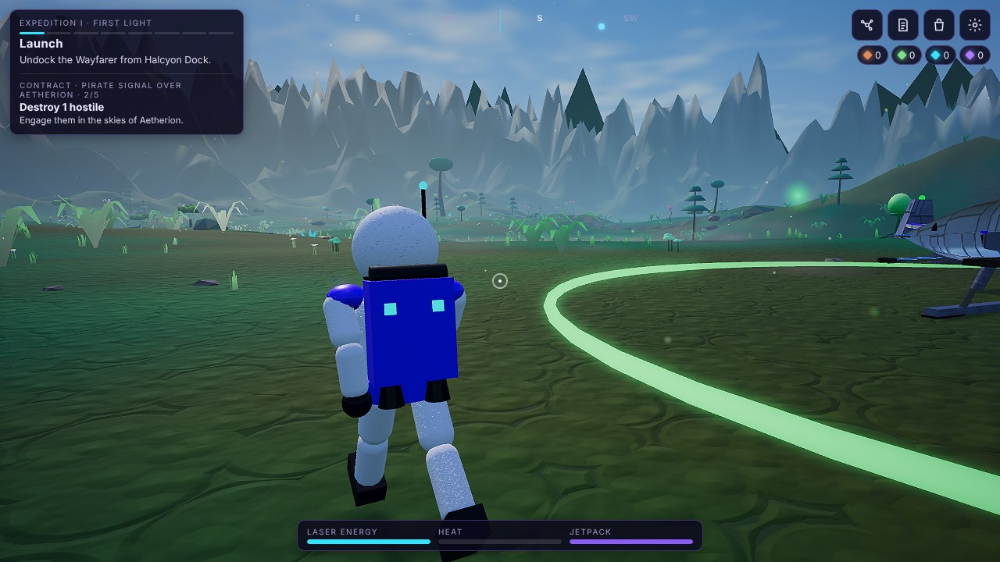
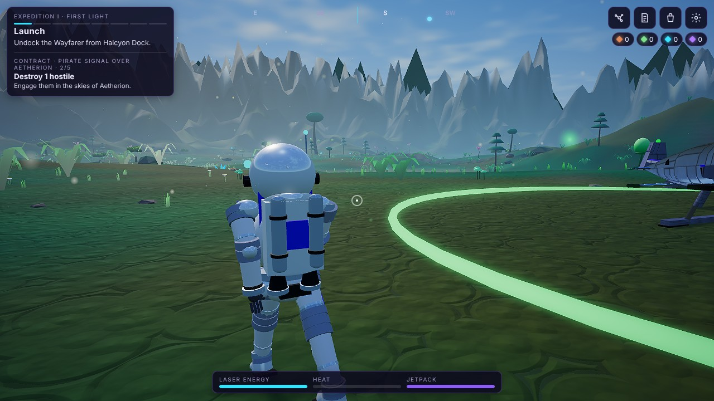
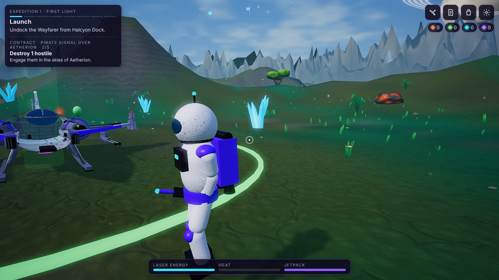
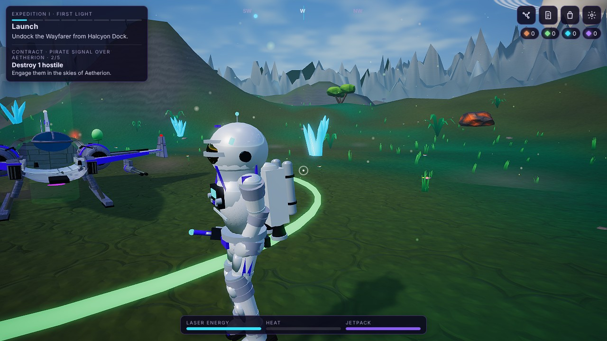

# Checkpoint A — Android Full: detailed astronaut

Part of the "Android cinematic realism first" priority. Android Full only; the Telegram Lite build keeps its original astronaut
(no further Lite visual work until the Android experience is approved). Shared rules, farming, sync and parity tests are untouched.

> **Not measured on a real phone.** All screenshots are from the actual game in headless Chromium with a software rasteriser
> (SwiftShader, Extreme HD preset); the cost numbers are geometry counts, not frame rates. Nothing here is a device-performance claim.

## Before / after (real game, Aetherion, Extreme HD preset, same camera)

| | Before | After |
|---|---|---|
| Front |  |  |
| Side |  |  |
| Running |  |  |
| Jetpack key held |  |  |

(The jetpack frames do not show flames: in the capture the character was not yet airborne. The flame meshes themselves were not visually verified in this checkpoint.)

## What is implemented
`src/presentation/full/astronautFull.ts` — original procedural geometry, no downloaded or licensed assets.

* **Suit layering:** fabric under-layer with accordion pleats at hips, knees, shoulders and elbows; hard armour shells (chest, shoulders, thighs, knees, shins,
  boots); metal bearing rings at neck, shoulders, wrists, waist and ankles; reflective strips; harness straps; accent patches.
* **Helmet:** shell with chin piece, rim ring, neck seal, side comms pods, helmet lamps, antenna, **gold mirrored visor** (reflects the environment on the PBR tiers).
* **Equipment:** chest control unit with lit display and switches; life-support backpack with twin tanks, valves and status lights; jetpack nozzles.
* **Hands/feet:** gloves with four modelled fingers and a thumb that curl (relaxed → tighter when running → grip on the mining tool); boots with sole, heel, toe cap and
  ankle joints that keep the soles level through the stride.
* **Animation (same inputs and same joint origins as before):** weight shift and breathing when idle, slow head scan, head stabilised against torso twist, backpack
  inertia on speed changes, sprint lean, airborne tuck, jetpack posture with gimballed flames, landing compression, ankle roll with push-off, finger curl.
* **Unchanged by design:** `Player` movement/physics, collider sizes and hit-boxes, boarding, mining-laser muzzle position (`muzzle` is at the identical local point),
  camera, input, saves, every rule.
* **Package split:** `src/presentation/astronaut.ts` resolves to the detailed model in Full and (via the Lite build plugin) to the original simple model in Lite;
  `tests/package-boundary.test.ts` proves Lite does not contain the new model and Full does not ship both.

## Rendering cost (geometry; measured with the game's own meshes)

| | Meshes (≈ draw calls, doubled in the shadow pass) | Triangles |
|---|---|---|
| Original astronaut | 36 | 20,018 |
| New astronaut | 41 | 18,272 |

My first attempt had 85 meshes / 92,696 triangles (torus pleats and high-segment spheres); that was rejected and rebuilt on two shared vertex-coloured materials with
cylinder-based rings and low-segment spheres. The new model therefore has more detail for slightly fewer triangles and 5 more meshes. The real GPU cost on a phone is **not measured**.

## Validation
* Typecheck clean; unit tests 116/116 (new: Lite/Full astronaut boundary).
* Journey (14 steps, includes landing and walking on foot) on the Full / Extreme HD bundle: **15/15** (software rendering).
* M1 smoke 25/25; M2 suite 46/46.
* Contract E2E: the escort scenario failed on CI at `94584cb`; see "CI" below.

## CI
Run for the commit that carries this checkpoint builds the debug APK (`galactic-frontier-android-debug-apk` artifact) and the Lite artifact.
At `94584cb` the **Contract E2E (station + escort) job failed**: station passed 8/8, but the escort ambush was not defeated in 42 game-seconds (player shield 0),
after passing on `410c5aa`. The test pilot's aim assist was driven by wall-clock polling from the harness; it now runs inside the game frame (`autoAim`).
It passed 6/6 locally under heavy CPU load, which is not proof. Until CI is green on this fix the build is **not** release-ready. If it fails again the
escort fight itself may be frame-rate sensitive in a way that matters for slow devices, which would need a gameplay-side look (not a visual change).

## Honest quality statement
This is a clear step up in detail and silhouette — believable suit layers, a real visor, hands, boots and equipment — but it is a hard-surface, stylised-realistic
character built from primitives. It is **not** film-grade: no sculpted anatomy, no authored textures, no skinned cloth. Reaching that would need authored or
properly licensed models (glTF) and baked PBR textures; that decision is yours (see "Decisions needed").

## Decisions needed
1. Are procedural primitives acceptable as the asset pipeline, or should I add support for glTF models that you provide / that are clearly licensed?
2. Approve this look (or give notes) before I start Checkpoint B (planets), since later checkpoints reuse the same material approach.

## Still planned
Phases B (six planets), C (galaxy, black hole, planetary atmospheres, warp), D (Wayfarer, enemy ships, combat effects), E (device measurements).
