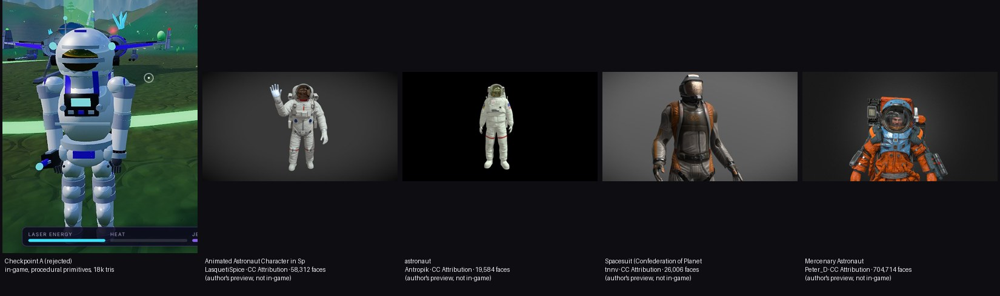

# Visual standard for hero assets (Android Full)

**Rule: visual realism is judged by the finished in-game appearance** — in the real renderer, at Extreme HD, on Aetherion lighting, at phone-screen scale — not by polygon
count, test coverage or the number of details added. The owner approves; nothing is "done" because a checklist passes.

## Why Checkpoint A failed (the owner's verdict: still cartoonish)

| Aspect | Checkpoint A (procedural primitives) | What the realistic candidates do |
|---|---|---|
| **Form** | Built from ellipsoids, discs and tapered cylinders: tube limbs, a ball helmet, box backpack. The silhouette reads as a toy/robot however many pieces are added; the pleated "joints" are stacked discs. | Sculpted anatomy and suit construction: shoulders and torso taper, bent joints with fabric gathers, boots with real soles, gloves with finger volume, harness straps lying *on* the surface. |
| **Surface detail** | Two shared materials; every colour is a flat per-vertex colour. No authored albedo, no baked normal map, no ambient occlusion. Smallest feature ≈ 5 cm. | 5-109 authored textures (4K): fabric weave, stitching, scuffs, edge wear, labels, panel seams; normal maps **baked from 0.5-2 M-poly sculpts** so a 20-30k-tri mesh carries the detail of a million. |
| **Material response** | Uniform roughness/metal per material → "white plastic", tinted by the sky; the visor is one smooth ellipsoid. | Roughness/metal vary per fabric, rubber, anodised metal, glass; AO in the creases; visor is a real reflective shell with an inner face. |
| **Proportions** | Oversized helmet and backpack, tiny hands, uniform limb thickness. | Referenced to human proportions (one candidate states it uses a standard human base). |
| **Spending the budget** | 18,272 triangles — mostly spent on sphere tessellation, nothing on form. | Antropik: 19,584 triangles — *the same budget*, but authored topology + baked detail. Triangle count was never the problem. |

Conclusion: more procedural pieces cannot close this gap. The missing ingredient is **authored geometry and authored/baked textures** — a different asset pipeline, which
`docs/ASSET-PIPELINE.md` implements. The procedural astronaut remains only as the safe fallback and must never be presented as the realistic model.

## Acceptance checklist (the owner signs off on screenshots from the actual game)

Each item is captured **in-game** (Extreme HD preset, Aetherion, real lighting) at 1080p and reviewed; an external Blender render does not count.

1. Front view, standing.  2. Side view.  3. Rear view (backpack, hoses, harness).  4. Walking.  5. Sprinting.  6. Jumping / landing.  7. Jetpack flight.
8. Mining pose (right arm raised, tool/beam origin correct).  9. Close-up of helmet and visor (reflection, inner face, rim, lamps).  10. A gameplay frame from the normal camera distance.

Pass conditions (necessary, not sufficient):

* no visible primitive silhouettes (no tube limbs, ball helmet, box pack);
* authored base-colour + normal + ORM maps present (Extreme HD ≥ 2K, Enhanced ≥ 1K), normal baked from high-poly;
* materials not flat: fabric, rubber, metal and glass visibly differ under the sun and in shade; visor reflects the environment;
* animation: feet stay planted without obvious sliding, joints bend where a human's do, no mesh tearing at shoulders/hips/knees;
* unchanged: collision, hit-boxes, interaction distances, boarding, mining muzzle origin, camera, input (verified by the existing journey / contract / parity tests);
* **owner approval of the screenshots.**

Performance is reported separately and only from a physical device: sustained FPS, 1 % lows, frame times, memory, adaptive render scale, thermals (`?perf=1` recorder).
Cloud/software-rendered numbers are never presented as Android performance.
